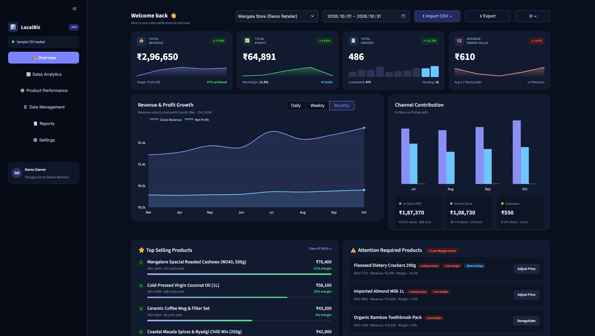
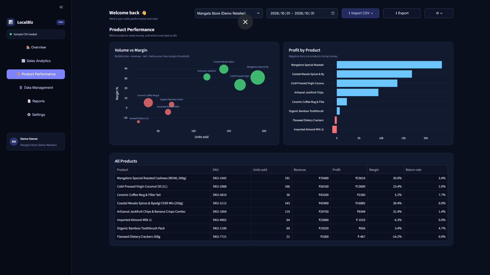

# LocalBiz Analytics: Sales Intelligence Dashboard

Turn a shop's raw sales file into a clear dashboard: how much was sold, which products make money, which ones leak profit, and when customers buy.

Built with **Python, Pandas, Plotly and Streamlit**. UI designed in Stitch.

> **Live demo:** _add your Streamlit link here after deploying_
>
> All data in this repository is **fictional demo data**. No real business is represented.

## Screenshots

| Overview | Product Performance |
|---|---|
|  |  |


## What it does

- **Imports almost any sales file:** CSV or Excel. Columns are matched automatically (`Qty`, `Rate`, `Item`, `Bill No`...) and can be fixed on a mapping screen.
- **Cleans the data:** removes duplicates and unusable rows, fills gaps, handles refunds, and tells you every assumption it made.
- **Overview:** revenue, profit, orders and average order value with trend vs the previous period, a revenue and profit trend (daily, weekly, monthly), channel split, top products and a list of products that need attention.
- **Sales Analytics:** revenue by weekday, by category and by hour, plus a monthly summary.
- **Product Performance:** volume vs margin chart, profit by product and a full product table.
- **Reports:** downloadable Excel report, product CSV and a plain-text summary.
- **Settings:** choose what counts as a low-margin or high-return product.

## Run it locally

```bash
git clone https://github.com/dhruv64termux/localbiz-analytics.git
cd localbiz-analytics

python -m venv venv
venv\Scripts\activate          # Windows
# source venv/bin/activate     # macOS / Linux

pip install -r requirements.txt
streamlit run app.py
```

The app opens with sample data. Use **Import CSV** in the top bar to load your own file.
To regenerate the sample data: `python generate_data.py`.

## Your file

| Needed | Column (any similar name works) |
|---|---|
| Yes | order date, product name, and either unit price **or** total sales amount |
| Optional | quantity, unit cost (or profit), order ID, channel, category, status, customer ID, SKU, shipping cost |

Without a cost or profit column, profit equals revenue and margins are overstated. The app warns you when this happens.
Test files in different formats are in `data/test_files/`.

## Project structure

```
app.py                 Streamlit dashboard (pages, charts, UI)
generate_data.py       Creates the fictional sample dataset
src/cleaning.py        Column detection, validation and cleaning
src/metrics.py         KPIs, trends, product analysis, insights
data/                  Sample data and test files
.streamlit/config.toml Dark theme
```

## Roadmap

- User accounts with email OTP login and saved data per user
- Add, edit and delete sales rows inside the app
- More report formats

## Tech stack

Python · Pandas · NumPy · Plotly · Streamlit · openpyxl
